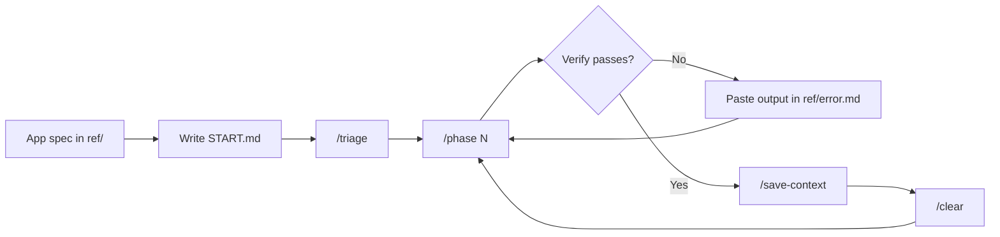

<div align="center">

# Claude Code Project Template

**Build apps with Claude Code in small, planned phases.**
Fast reasoning. Low token use. Nothing you don't need.


[Quick start](#quick-start) · [START.md](#using-startmd) · [Commands](#commands) · [Folders](#folders) · [Customize](#customize)

</div>

---

## How it works

You describe your app in one markdown file. Claude splits the work into **phases**, and each phase fits in one Claude session. Build a phase, verify it, save, clear, repeat.



**Why it stays cheap:** workflow instructions live in skills that load only when you call them, and folder rules load only when Claude opens that folder. Every message carries just the essentials.

---

## Quick start

> [!NOTE]
> You need [Claude Code](https://code.claude.com/docs/en/setup.md) and Git installed.

### 1. Write your app spec

Ask Claude (claude.ai or any chat) to write a detailed spec for your app:

```text
I want to build <your app idea>. Ask me questions one at a time until you
understand it, then write a detailed markdown spec covering: purpose, users,
features, screens, data, tech stack, and security needs.
```

Save the result as a `.md` file, for example `my-app-spec.md`.

### 2. Clone the template

```bash
git clone https://github.com/<your-username>/<this-repo>.git my-app
cd my-app
```

Start a fresh git history so your project doesn't inherit the template's commits:

| macOS / Linux | Windows PowerShell |
|---|---|
| `rm -rf .git && git init` | `Remove-Item -Recurse -Force .git; git init` |

### 3. Add your spec

Move your spec into the `ref/` folder:

```text
my-app/
└── ref/
    └── my-app-spec.md
```

### 4. Plan the project

Write your first task in `START.md` ([how START.md works](#using-startmd)):

```text
Prepare my project using the .md file in the ref folder and create all the
plans needed for the project. If there are open questions, address them at
the phase they affect.
```

Launch Claude Code in the project root and run:

```text
/triage
```

Claude reads your spec, creates the phases in `plans/`, and clears `START.md`. No code is written yet.

### 5. Build a phase

```text
/phase 1
```

If the phase has open questions, Claude asks them first. Then it builds the whole phase and ends with a **Verify** list of commands for you to run.

- **Something fails?** Paste the output into `ref/error.md` and tell Claude to read it.
- **Everything passes?** Tell Claude the phase is verified.

### 6. Save and move on

```text
/save-context
/clear
/phase 2
```

`/save-context` records exactly where work stopped, so the next session resumes from files alone. Repeat steps 5 and 6 until every phase is done.

---

## Using START.md

`START.md` is your **inbox**. Anything you want built, changed or fixed goes here first. Claude turns it into planned phases when you run `/triage`.

**How to use it:**

1. Open `START.md` and write your tasks under the header. Plain sentences are fine. No format required.
2. Run `/triage`.
3. Claude files each task into the right phase (new or existing), copies your wording into that phase so nothing is lost, and clears `START.md`.

**Example:**

```markdown
# START

Untriaged tasks. Write freely, then run `/triage`.

- Add a dark mode toggle to the settings page
- Login should lock the account after 5 failed attempts
- The export button on the reports page crashes with large files
- Read ref/payments-notes.md and plan Stripe checkout
```

> [!TIP]
> Use `START.md` any time, not only at the beginning. New idea mid-project? Write it down, finish your current phase, then run `/triage`. Claude slots it in without redoing finished work.

> [!IMPORTANT]
> Don't put tasks in chat when you could put them in `START.md`. Chat is lost when you `/clear`; files are not.

---

## Commands

| Command | Run it when | What happens |
|---|---|---|
| `/triage` | You wrote tasks in `START.md` | Tasks become phases in `plans/` |
| `/phase N` | Starting or resuming phase N | Claude builds the phase, then gives you Verify steps |
| `/save-context` | Ending a session | Progress saved, buildlog written |
| `/clear` | After saving | Built in. Starts a fresh session |

---

## Folders

```text
my-app/
├── CLAUDE.md          Rules Claude reads every session
├── START.md           Your task inbox
├── src/               Your app code (has its own CLAUDE.md for code rules)
├── design/            Architecture, data flow, security, UI, UX
├── buildlogs/         One short note per session: why things changed
├── plans/             Phases and progress          (not in git)
├── ref/               Your spec, decisions, errors (not in git)
└── .claude/skills/    The /triage, /phase and /save-context workflows
```

---

## Customize

| File | What to change |
|---|---|
| `CLAUDE.md` | Replace the top comment with one line about your app. Edit **Environment** to say who runs tests and builds (you or Claude). |
| `src/CLAUDE.md` | Add your code rules (style, testing, error handling), one line each. |

> [!TIP]
> Comments written as `<!-- ... -->` inside CLAUDE.md files are stripped before Claude reads them, so leftover placeholders cost no tokens.

---

## Tips

- **One phase per session.** Run `/save-context` and `/clear` between phases, even with room left. A fresh session is cheaper and sharper.
- **Match the model to the job.** Sonnet for routine phases, Opus for planning.
- **Check your context.** `/context` shows what is using space.
- **Files over chat.** Anything Claude must remember belongs in a file.

---

## License

[MIT](LICENSE). Created by **Vincent Herrera**. Free to use, modify and share; keep the copyright notice in copies of the template itself.
